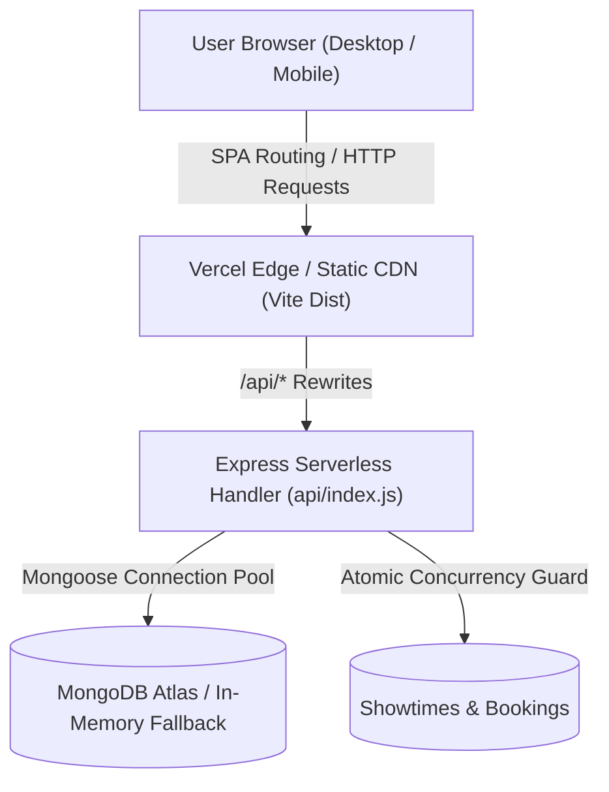
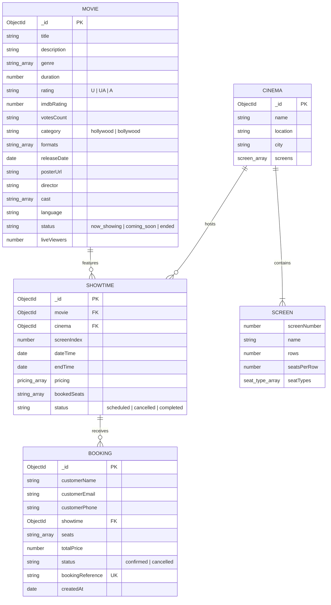

# IMovies — Cinema Booking & Management System

IMovies is a high-performance cinema ticketing and theater management web application built with Node.js, Express, MongoDB (Mongoose), and React (Vite). Designed with BookMyShow-grade user experience, it features real Hollywood & Bollywood blockbuster catalogs with verified IMDb ratings, real-time urgency metrics, dynamic simulated live seat bookings, zero-friction guest checkout (no login required), visual interactive seat selection, and atomic concurrency safety.

---

## Key Features

1. **Direct Zero-Friction Booking (No Auth Required)**:
   - Users browse movies, select cinema showtimes, pick seats, enter guest details (Name, Email, Phone), and receive an instant booking confirmation reference (`IMV-XXXXXXXX`).
   - "My Bookings" automatically loads tickets booked on the current device (via `localStorage`) or allows searching any ticket by reference ID without logging in.

2. **Real Blockbuster Catalog (Hollywood & Bollywood)**:
   - 12 real movies seeded with official titles, plot summaries, runtimes, verified IMDb ratings (e.g. *Oppenheimer* 8.9, *12th Fail* 8.8, *Interstellar* 8.7, *Spider-Verse* 8.6, *Dune: Part Two* 8.5, *Deadpool & Wolverine* 7.7, *Stree 2* 7.6, *Kalki 2898 AD* 7.6, *Gladiator II* 7.1, *Fighter* 7.0, *Jawan* 7.0, *Dunki* 6.7).
   - High-definition local poster images stored in `/posters/` — eliminates broken image hotlinking and CDN failures.
   - Format badges: **IMAX 70mm**, **IMAX 3D**, **4DX**, **Dolby Atmos**, **Laser 2D**.

3. **BookMyShow-Style Real-Time Cinema Dynamics**:
   - **Live Urgency Indicators**: Real-time ticker showing active viewers (e.g. *"🔥 3,200 people viewing now"*).
   - **Simulated Real-Time Seat Occupancy**: While customers are selecting seats on the interactive seat matrix, other seats are periodically reserved in real-time with instant notification toasts.
   - **Category & Genre Filters**: Instant switching between All Movies, Hollywood, Bollywood, and Genre chips with live instant search.

4. **Atomic Concurrency & Concurrency Protection**:
   - MongoDB atomic operator `$addToSet` combined with `$nin` ensures multiple simultaneous booking requests can never double-book the same seat.
   - One-click booking cancellation atomically releases seats back to availability via `$pullAll`.

5. **Cloud-Ready & Vercel Optimized**:
   - Single-command root build.
   - Serverless API wrapper in `/api/index.js` with database connection pooling and automatic in-memory MongoDB fallback.
   - Zero API keys or secrets committed to git.

---

## Architecture Overview



---

## Database Schema



---

## Project Structure

```
Imovies/
├── .gitignore                      # Excludes node_modules, .env, dist, and build caches
├── README.md                       # Comprehensive system documentation
├── package.json                    # Root scripts for Vercel unified build & deployment
├── vercel.json                     # Vercel serverless routing & SPA rewrites configuration
├── api/
│   └── index.js                    # Serverless entry point wrapping Express server
├── backend/
│   ├── .env.example                # Template for environment variables (no secrets)
│   ├── package.json                # Backend dependencies and test scripts
│   ├── server.js                   # Express application setup and API routing
│   ├── seed.js                     # Standalone database seeder
│   ├── seedHelper.js               # Seed definitions with 12 real movies and showtimes
│   ├── config/
│   │   └── db.js                   # Mongoose connection with serverless caching & memory fallback
│   ├── middleware/
│   │   ├── asyncHandler.js         # Async error wrapper
│   │   └── errorHandler.js         # Centralized error handler
│   ├── models/
│   │   ├── Booking.js              # Booking schema with guest fields & reference generator
│   │   ├── Cinema.js               # Cinema and Screen layout schemas
│   │   ├── Movie.js                # Movie schema with IMDb rating, category, and formats
│   │   ├── Showtime.js             # Showtime schema with seat pricing and booked seats
│   │   └── User.js                 # User schema
│   ├── routes/
│   │   ├── bookings.js             # Public direct guest booking, lookup & cancellation
│   │   ├── cinemas.js              # Cinema list & management
│   │   ├── dashboard.js            # Operational metrics & analytics
│   │   ├── movies.js               # Movie catalog & filters
│   │   └── showtimes.js            # Showtime schedules & seat queries
│   └── tests/
│       ├── auth.test.js            # Auth validation tests
│       ├── booking.test.js         # Concurrency & seat booking integration tests
│       └── movies.test.js          # Catalog filtering & validation tests
└── frontend/
    ├── .env.example                # Frontend environment template
    ├── index.html                  # HTML entry point
    ├── vite.config.js              # Vite build & proxy configuration
    ├── public/
    │   └── posters/                # 13 high-resolution local movie posters
    └── src/
        ├── App.jsx                 # Direct routing (all public pages accessible)
        ├── main.jsx                # React root
        ├── api/
        │   └── axios.js            # Axios client with base URL configuration
        ├── components/
        │   ├── booking/            # SeatMap, ScreenIndicator, Legend
        │   ├── common/             # MovieCard with IMDb ribbons & badges, Navbar, Footer
        │   └── layout/             # Responsive Navbar with live search
        ├── pages/
        │   ├── Home.jsx            # BookMyShow hero, search, trending, Hollywood & Bollywood
        │   ├── Movies.jsx          # Tabbed catalog (All / Hollywood / Bollywood)
        │   ├── MovieDetail.jsx     # Detail view with IMDb rating, urgency ticker, showtimes
        │   ├── SeatSelection.jsx   # Interactive seat map with live simulated booking
        │   ├── BookingConfirmation.jsx # Printable receipt with QR placeholder & reference
        │   ├── MyBookings.jsx      # Guest booking manager with cancellation
        │   ├── Cinemas.jsx         # Cinema directory & screen specs
        │   └── admin/              # Management & dashboard screens
        └── styles/
            └── movies.css          # BookMyShow-grade dark mode styling
```

---

## Installation & Local Startup

### Prerequisites
- Node.js (v18 or higher; tested on Node.js v24)
- npm (v9 or higher)
- Optional: MongoDB installed locally, OR MongoDB Atlas connection string. If MongoDB is not running locally, the backend **automatically starts an in-memory MongoDB instance** and seeds it.

### Step 1: Install Dependencies
```bash
# In the project root:
npm install

# In backend:
cd backend
npm install
cd ..

# In frontend:
cd frontend
npm install
cd ..
```

### Step 2: Environment Configuration
Copy `.env.example` templates to `.env`:
```bash
# Backend .env
cp backend/.env.example backend/.env

# Frontend .env
cp frontend/.env.example frontend/.env
```

`backend/.env.example`:
```env
PORT=5000
NODE_ENV=development
MONGODB_URI=mongodb://localhost:27017/imovies
JWT_SECRET=supersecret_imovies_jwt_key_change_in_production
JWT_EXPIRE=7d
```

`frontend/.env.example`:
```env
VITE_API_URL=/api
```

*(Note: Sensitive keys are never committed; `.gitignore` strictly excludes all `.env` files).*

### Step 3: Run the Application
In separate terminal sessions:

**Start Backend (Port 5000):**
```bash
cd backend
npm run dev
# Or node server.js
```
*The backend connects to MongoDB, auto-seeds 12 real blockbuster movies, 3 multiplexes, and 48 showtimes if the database is empty, and starts listening on port 5000.*

**Start Frontend (Port 5173):**
```bash
cd frontend
npm run dev
```
Open [http://localhost:5173](http://localhost:5173) in your browser.

---

## Running the Automated Test Suite

Run the complete backend test suite using Jest:
```bash
cd backend
npm test
```

### Genuine Test Results
```
PASS tests/movies.test.js
PASS tests/booking.test.js
PASS tests/auth.test.js

Test Suites: 3 passed, 3 total
Tests:       22 passed, 22 total
Snapshots:   0 total
Time:        8.913 s
Ran all test suites.
```

### Production Build Verification
```bash
cd frontend
npm run build
```
```
vite v8.3.5 building client environment for production...
✓ 113 modules transformed.
rendering chunks...
dist/index.html                   0.45 kB
dist/assets/index-CJcD53rM.css   58.60 kB
dist/assets/index-MUA7Yld2.js   449.15 kB
✓ built in 256ms
```

---

## Vercel Deployment Guide

The repository includes native Vercel configuration (`vercel.json` + `api/index.js` + root `package.json` build script) to deploy as a unified full-stack application.

### 1. Push Repository to GitHub
Ensure all code is committed and pushed:
```bash
git add .
git commit -m "feat: complete IMovies cinema booking platform with BookMyShow features and zero-auth workflow"
git push -u origin main
```

### 2. Connect to Vercel
1. Log in to [vercel.com](https://vercel.com) and click **"Add New..." > "Project"**.
2. Select your repository: `https://github.com/YaMa04062005/I-Movies`.
3. Set **Framework Preset**: `Vite`.
4. Set **Root Directory**: `./`.
5. Under **Environment Variables**, provide:
   - `MONGODB_URI`: Your MongoDB Atlas URI (e.g. `mongodb+srv://<user>:<password>@cluster0.mongodb.net/imovies?retryWrites=true&w=majority`)
   - `NODE_ENV`: `production`
6. Click **Deploy**. Vercel runs `npm run build` and serves both the static frontend and the serverless Express API on the same domain.

---

## Git Authentication Guide

Remote is set to `https://github.com/YaMa04062005/I-Movies.git`.

If pushing prompts for credentials or rejects access:
1. Generate a GitHub Personal Access Token (PAT) with `repo` scope at [github.com/settings/tokens](https://github.com/settings/tokens).
2. Push with the token:
```bash
git push https://<YOUR_GITHUB_TOKEN>@github.com/YaMa04062005/I-Movies.git main
```
Or update the remote origin to include the token:
```bash
git remote set-url origin https://<YOUR_GITHUB_TOKEN>@github.com/YaMa04062005/I-Movies.git
git push -u origin main
```
